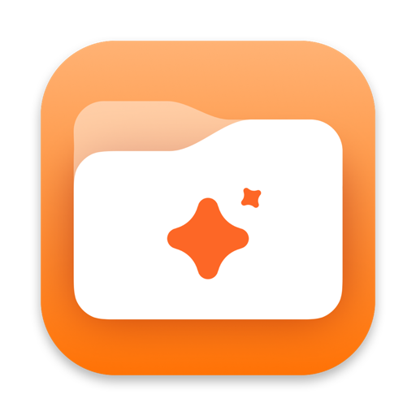
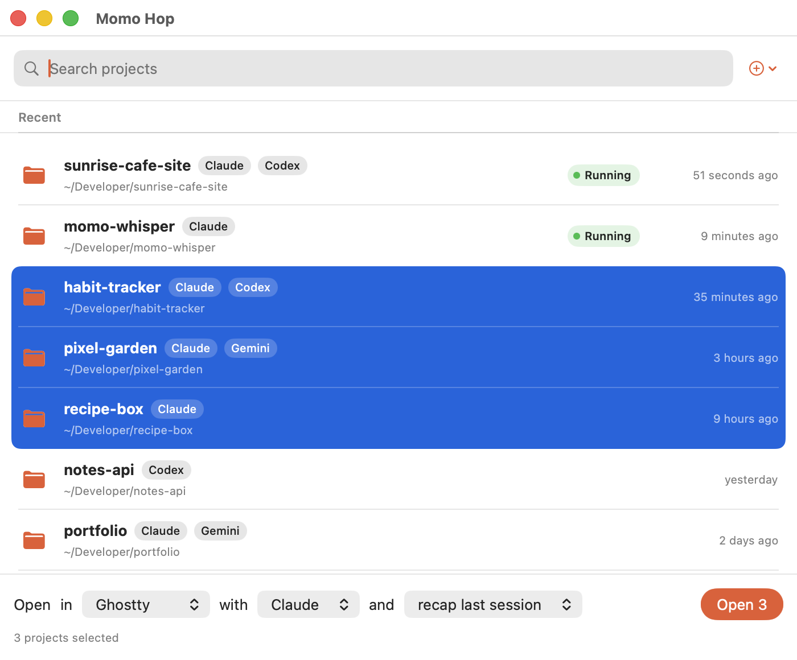

<p align="center">
  
</p>

<h1 align="center">Momo Hop</h1>

<p align="center">
  <a href="LICENSE"></a>
  
  
</p>

<p align="center">
  <b>Hop into any project in one click.</b><br>
  A small Mac app that lists your projects and opens the one you pick in your terminal or editor, with your AI coding tool already running.
</p>

<p align="center">
  
</p>

Works with **Claude Code, Codex CLI, Gemini CLI, OpenCode, Aider and Cursor**, in **Terminal, Ghostty, Alacritty, VS Code, Zed, Xcode** and more.

## What it does

Getting back into a project usually means: open a terminal, `cd` somewhere, remember which AI tool you used, type its command, resume the chat.
Momo Hop turns that into: **pick a project, press Enter.**

I built it because I never dared to close my terminal tabs (what if I lose the chat?) and I was too lazy to `cd` and type the command again and again.

- **One list for all your AI tools.** Built from each tool's own history. Each row shows which tools you used there, and when.
- **Choose how to open it.** Where (terminal or app), which AI tool, and whether to continue the last chat, recap it, or start fresh.
- **Open several at once.** Shift- or Cmd-click to select a few projects, press Open (**Open 3**), and each one gets its own tab or window. Selecting more than 8 asks first.
- **See what is running.** A green **Running** label marks projects where Claude Code or Codex is running right now.
- **No accidental double sessions.** If your chosen tool is already running in a project, Momo Hop asks before opening another one (Cancel is the default; tick *Don't ask me again* to skip it, and turn it back on in the **＋** menu).
- **Remembers your choices.** Hides tools you don't have installed.
- **Private.** Everything is read locally. No network, no accounts, no analytics.

## Install

Needs macOS 14+ and the Xcode Command Line Tools (`xcode-select --install`). No dependencies.

```bash
git clone https://github.com/Nabhak/momo-hop.git
cd momo-hop
./build.sh
```

The app is built to `~/Applications/Momo Hop.app`, plus a zip in `dist/`.

A zip copied to another Mac is not notarized, so macOS blocks it at first. Run:

```bash
xattr -dr com.apple.quarantine "/Applications/Momo Hop.app"
```

## Use

1. Open Momo Hop and type to filter.
2. Double-click a project, or select it and press Enter.
3. Use the bar at the bottom to change **in** (terminal or app), **with** (AI tool) and **and** (continue, recap, new chat). Select several projects and the button becomes **Open 3**.
4. Missing a project? Use the **＋** button to add a folder, or a folder of projects.

<details>
<summary><b>Supported tools and apps</b></summary>

| Tool | Shows history | Continue last chat | Recap |
|---|:-:|:-:|:-:|
| [Claude Code](https://docs.claude.com/en/docs/claude-code) | ✅ | ✅ | ✅ |
| [Codex CLI](https://github.com/openai/codex) | ✅ | ✅ | – |
| [Gemini CLI](https://github.com/google-gemini/gemini-cli) | ✅ | – | – |
| [OpenCode](https://opencode.ai) | ✅ | ✅ | – |
| [Aider](https://aider.chat) | ✅ | ✅ | – |
| Cursor | ✅ | opens as app | – |

**Terminals:** Ghostty (new tab), Terminal and Alacritty (new window).
**Apps:** VS Code, Cursor, Windsurf, Zed, Sublime Text, Nova, Xcode, Codex desktop app.

</details>

<details>
<summary><b>How it works, permissions and limits</b></summary>

- Reads each tool's history files (`~/.claude/projects`, `~/.codex/sessions`, `~/.gemini/projects.json`, `~/.local/share/opencode`, `.aider.chat.history.md`, Cursor's recent workspaces). Also finds folders in `~/Documents/GitHub`, `~/Developer`, `~/Projects`, `~/Code` and similar.
- Writes a small temporary launch script and opens it in your terminal, so folder names are never pasted into a shell command.
- macOS may ask for **Automation → Ghostty** (to open a tab) and **Documents folder** access. The app is ad-hoc signed, so each rebuild may ask again.
- The **Running** label and the double-session warning only detect Claude Code and Codex (an interactive session in a terminal). They are checked when the list loads or when you use **Reload list** in the **＋** menu, so they can be a little out of date.
- History formats belong to each tool and may change. A missing badge is the worst case, never a crash.
- Tested on macOS 26, Apple Silicon. Intel and older macOS are untested.
- Claude Desktop can't open a given folder from outside yet ([anthropics/claude-code#54614](https://github.com/anthropics/claude-code/issues/54614)).

</details>

<details>
<summary><b>Development</b></summary>

The whole app is one file, `main.swift`. To add an AI tool: add a case to `AI`, a history reader in `Backend`, and a launch command in `Launcher.command`.

```bash
./build.sh                                                        # build + install + zip
"$HOME/Applications/Momo Hop.app/Contents/MacOS/MomoHop" --dump   # print the project list and exit
```

</details>

## License and credit

Free software under the [GNU GPL v3.0](LICENSE) or later. You may use, change and share it. If you share a modified version, you must share its source under the same license and keep the copyright notices.

**Credit:** if you build on Momo Hop, please say so, for example "Based on [Momo Hop](https://github.com/Nabhak/momo-hop) by Nabhak".

Momo Hop is an independent project, not affiliated with Anthropic, OpenAI, Google, Cursor or any other tool it works with. Product names belong to their owners.

Copyright © 2026 Nabhak.
